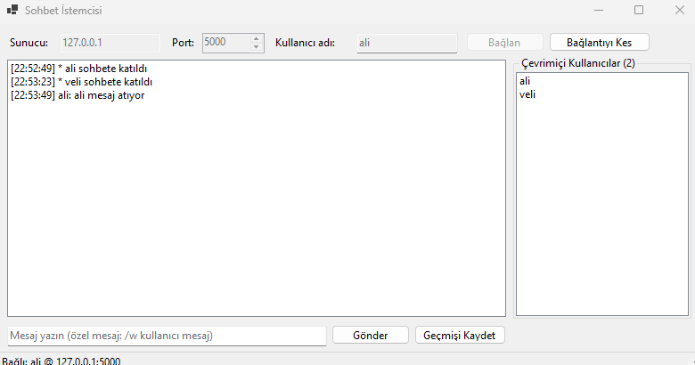
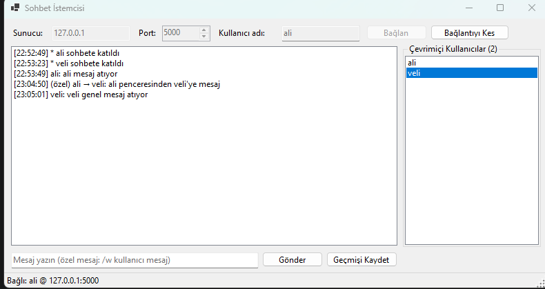

# YMH219-ChatApp (TCP Sohbet Uygulaması)

Aynı bilgisayarda veya yerel ağda çalışan bir sunucu ile birden çok istemciden oluşan C# Windows Forms sohbet uygulaması. İstemciler kullanıcı adıyla bağlanır; genel ve özel mesajlar zaman bilgisiyle gösterilir, sunucu bağlı istemcileri listeler. YMH 219 Nesne Tabanlı Programlama dersi ek uygulama ödevidir.

## Kullanılan teknolojiler

- C# / .NET 10, Windows Forms (`net10.0-windows`), ortak kütüphane `net10.0`
- `System.Net.Sockets`: `TcpListener`, `TcpClient`, `NetworkStream`
- `System.IO`: `StreamReader` / `StreamWriter` (satır tabanlı protokol)
- `System.Text.Json`: her satıra bir JSON mesaj
- `async/await`, `Task`, `CancellationToken`, `ConcurrentDictionary`, `SemaphoreSlim`
- Harici NuGet paketi kullanılmamıştır (hepsi .NET ile gelir)

## Kurulum ve çalıştırma

Gereksinim: .NET 10 SDK; tasarımcı için Visual Studio 2026 veya dotnet run

```
git clone https://github.com/mah0cb/YMH219-ChatApp.git
cd YMH219-ChatApp
```

### dotnet run ile (VS Code, 3 ayrı terminal)

Önce bir kez derleyin:

```
dotnet build
```

| Terminal | Komut | Yapılacak |
|---|---|---|
| 1 | `dotnet run --project ChatServer --no-build` | Port 5000, **Başlat** |
| 2 | `dotnet run --project ChatClient --no-build` | Kullanıcı adı `ali`, **Bağlan** |
| 3 | `dotnet run --project ChatClient --no-build` | Kullanıcı adı `veli`, **Bağlan** |

`--no-build` önemlidir: bir istemci açıkken ikinci `dotnet run` projeyi yeniden derlemeye çalışır ve çalışan `.exe` kilitli olduğu için hata verir.

### Visual Studio ile

1. `YMH219-ChatApp.sln` dosyasını açın.
2. Çözüme sağ tıklayın, **Configure Startup Projects... > Multiple startup projects** seçin.
3. `ChatServer` ve `ChatClient` için **Action = Start** yapın, `ChatServer` en üstte olsun.
4. F5 ile ikisi birlikte açılır. İkinci istemci için `ChatClient` projesine sağ tıklayıp **Debug > Start New Instance** seçin.

### Test adımları

1. Sunucuyu başlatın (port 5000).
2. İki istemciyi farklı kullanıcı adlarıyla bağlayın. Sunucu listesinde ikisi IP:port ve bağlanma zamanıyla görünür.
3. Bir istemciden mesaj gönderin (Enter veya **Gönder**), mesaj iki istemcide ve sunucu günlüğünde zaman bilgisiyle görünür.
4. Özel mesaj: sağdaki listede kullanıcıya çift tıklayın veya `/w kullanıcı mesaj` yazın.
5. Aynı kullanıcı adıyla üçüncü bir istemci bağlamayı deneyin, reddedilir.
6. Sunucuyu **Durdur**'la kapatın, istemciler uyarı verir ve kapanmaz.

### Aynı ağda farklı bilgisayarlarla test

- Sunucu bilgisayarının IP adresini `ipconfig` ile öğrenin (ör. `192.168.1.20`); istemcide **Sunucu** kutusuna bu adresi yazın.
- Sunucu ilk kez başlatıldığında **Windows Güvenlik Duvarı** izin isteyebilir. **Özel ağlar** için izin verin. İzin penceresi çıkmazsa ya da kapatıldıysa yönetici olarak açılan bir terminalde gelen bağlantıya izin verin:
  ```
  netsh advfirewall firewall add rule name="YMH219 ChatServer" dir=in action=allow protocol=TCP localport=5000
  ```
- İki bilgisayar aynı ağda olmalı; misafir ağları ve bazı okul ağları cihazlar arası bağlantıyı engelleyebilir.

## Temel özellikler

- Sunucu: port seçimi, Başlat/Durdur, bağlı istemciler listesi (kullanıcı adı, IP:port, bağlanma zamanı), olay günlüğü
- İstemci: sunucu adresi, port ve kullanıcı adıyla bağlanma, Bağlan / Bağlantıyı Kes, durum çubuğunda bağlantı durumu
- Gönderilen ve alınan tüm mesajlar `[SS:dd:ss]` zaman bilgisiyle gösterilir (zamanı sunucu basar, herkes aynı saati görür)
- Çok istemcili oda: mesajlar herkese yayınlanır (broadcast), katılma/ayrılma bildirimleri
- Çevrimiçi kullanıcılar listesi, her katılma/ayrılmada güncellenir
- Özel mesaj: listeden çift tıklama veya `/w kullanıcı mesaj` komutu
- Mesaj geçmişini `.txt` dosyasına kaydetme
- Enter ile mesaj gönderme

### Protokol

Her mesaj tek satırlık bir JSON'dur (`ChatMessage`: `Type`, `From`, `To`, `Text`, `Timestamp`). Türler: `Join`, `Leave`, `Chat`, `Private`, `UserList`, `System`.

```
{"Type":"Chat","From":"ali","To":"","Text":"merhaba","Timestamp":"2026-11-26T14:32:05"}
```

1. İstemci bağlanınca `Join` gönderir.
2. Sunucu adı kabul ederse `Join` mesajını herkese yayınlar ve ardından güncel `UserList`'i gönderir. Reddederse `System` mesajıyla nedenini bildirip bağlantıyı kapatır.
3. Sunucu gelen mesajlarda `From` ve `Timestamp` alanlarını kendisi doldurur; böylece istemci başkasının adıyla mesaj gönderemez.

### Hata yönetimi

| Durum | Davranış |
|---|---|
| Port meşgul | Sunucuda "Port Meşgul" uyarısı, farklı port seçilebilir |
| Sunucu kapalı / adres yanlış | İstemcide "çalışan bir sunucu yok" veya "adres bulunamadı" uyarısı |
| Sunucu yanıt vermiyor | 5 saniye sonra zaman aşımı uyarısı |
| Bağlantı koptu / sunucu durdu | İstemcide "Bağlantı Koptu" uyarısı, form bağlanmaya hazır duruma döner |
| Aynı kullanıcı adı (büyük/küçük harf duyarsız) | Bağlantı reddedilir, istemcide ve sunucu günlüğünde nedeni gösterilir |
| Geçersiz kullanıcı adı | Boş, 20 karakterden uzun, boşluk veya virgül içeren adlar kabul edilmez |
| Olmayan kullanıcıya özel mesaj | Gönderene sistem uyarısı |
| Bozuk JSON satırı | Satır atlanır, bağlantı devam eder |
| Geçmiş dosyası yazılamıyor | Hata mesajı gösterilir |

Hiçbir durumda uygulama kapanmaz. Ağ işlemleri arka plan thread'lerinde çalışır; arayüz güncellemeleri `BeginInvoke` ile UI thread'ine aktarılır.

### Proje yapısı

| Dosya | Görev |
|---|---|
| `ChatCommon/Models/ChatMessage.cs`, `MessageType.cs` | Mesaj modeli ve türleri |
| `ChatCommon/Protocol/MessageSerializer.cs` | Tek satır JSON serileştirme |
| `ChatCommon/Protocol/UsernameRules.cs` | Sunucu ve istemcinin ortak kullanıcı adı kuralları |
| `ChatServer/Services/ChatServer.cs` | `TcpListener`, istemci kabulü, `ConcurrentDictionary`, broadcast, özel mesaj, event'ler |
| `ChatServer/Services/ClientConnection.cs` | Tek istemcinin akışı ve okuma döngüsü |
| `ChatServer/Forms/SunucuForm.cs` | Sunucu arayüzü |
| `ChatClient/Services/ChatClient.cs` | Bağlanma, gönderme, okuma döngüsü, `MessageReceived` / `Disconnected` event'leri |
| `ChatClient/Services/ChatHistoryExporter.cs` | Geçmişi `.txt`'ye yazma |
| `ChatClient/Services/ChatConnectionException.cs`, `DisconnectedEventArgs.cs` | Bağlantı hatası ve kopma bilgisi |
| `ChatClient/Forms/IstemciForm.cs` | İstemci arayüzü |

## Ekran görüntüleri

**Sunucu: bağlı istemciler ve günlük**



**İstemci: genel ve özel mesajlar, çevrimiçi kullanıcılar**



## Bilinen sınırlamalar / geliştirme notları

- Bağlantı şifrelenmez ve parola yoktur; yalnızca güvenilir yerel ağ için uygundur.
- Mesaj geçmişi sunucuda saklanmaz; sonradan bağlanan kullanıcı eski mesajları görmez.
- Sunucu yalnızca IPv4 üzerinden dinler (`IPAddress.Any`).
- Bağlantının sessizce kopması (ör. ağ kablosu çekilmesi) ancak bir sonraki gönderimde veya işletim sisteminin TCP zaman aşımında fark edilir; heartbeat (ping) mesajı eklenebilir.
- Sunucu günlüğü özel mesajları da gösterir (ders amaçlı izleme için).

## Öğrenci

Mahmut Başcı, 205542016
